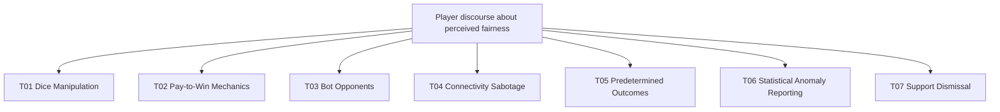
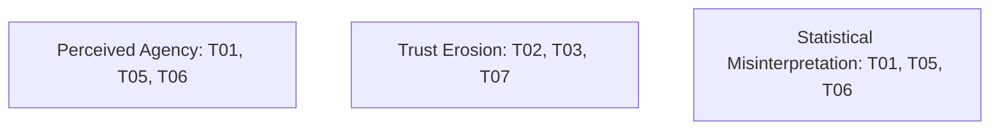
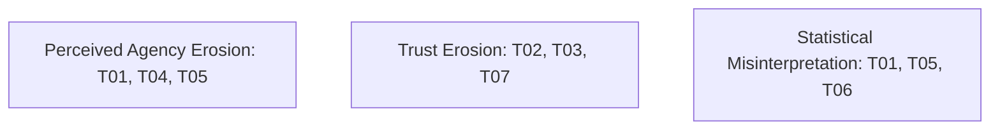

# Figures and Research Visuals

This index defines figures supported by the two manuscripts. No chart image files or raw datasets are included here.

## Figure 1 — Persian-language fairness-related complaint rate: shared endpoints
**Recommended form:** two-point comparison or slope marker.

| Year | Rate | Source |
|---|---:|---|
| 2022 | 3% | Both manuscripts |
| 2026 | 18% | Both manuscripts |

**Caption:** Both manuscripts report an increase from 3% in 2022 to 18% in 2026 in the Persian-language fairness-related complaint rate. Intermediate annual values differ and are not plotted as one reconciled series.

This is a rate reported in the manuscripts, not a measure of the proportion of all players who distrust the game and not evidence of technical manipulation.

## Figure 2 — Seven operational themes
**Recommended form:** theme taxonomy.

Source: both preprints. Seven themes; no frequencies are implied.

## Figure 3 — Source-specific meta-theme mappings

### Longitudinal manuscript

### Cross-cultural manuscript

The longitudinal manuscript assigns identical membership to Perceived Agency and Statistical Misinterpretation. Preserve this as a source discrepancy pending author clarification.

## Figure 4 — Corpus overview

| Dataset | Reported size | Role |
|---|---:|---|
| Persian-language review corpus | 52,000+ | Primary longitudinal corpus |
| Longitudinal detailed sample | ≈500 review/support items | Qualitative coding across five cohorts |\n| Cross-cultural Persian-language detailed sample | ≈500 reviews | Qualitative coding across five cohorts |
| Anglophone source corpus | 4,116 | Comparative source corpus |
| Anglophone detailed sample | 750 (150/year) | Stratified comparative sample |

## Figure 5 — Ten-stage Player Journey of Distrust
The longitudinal manuscript reports:
1. First notable losing streak
2. Asymmetric outcome observation
3. First suspicion of manipulation
4. Active pattern-seeking begins
5. Perceived confirmation obtained
6. Support contact initiated
7. Perceived support dismissal
8. Public complaint or warning
9. Temporary disengagement
10. Return to play

The model is interpretive, not deterministic. The cross-cultural manuscript presents a related model with some wording differences; transcribe its labels separately if creating a cross-cultural figure.

## Figure 6 — Cross-cultural comparison
**Recommended form:** qualitative comparison matrix of shared themes, complaint trajectories, complaint framing, statistical reasoning, and platform-response structures.

Do not plot Persian and anglophone percentages as directly comparable. Sampling frames and denominators differ.

## Figure production rules
- Label statistics with source manuscript, denominator, and sampling context.
- Distinguish findings, interpretation, and design implications.
- Do not infer causality from observational review/support data.
- Do not present player allegations as verified system behaviour.
- Do not include raw or searchable quotations.
- Do not include client/game names, logos, app-store links, screenshots, or identifying metadata.
