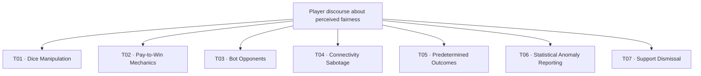
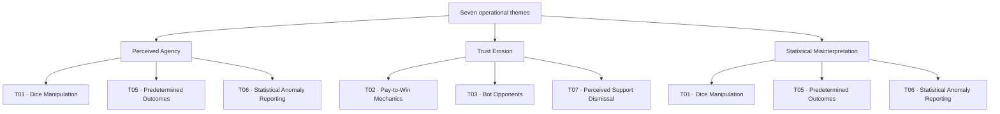
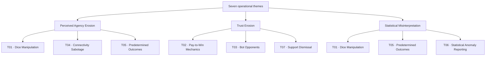
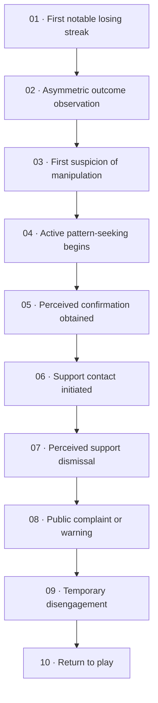
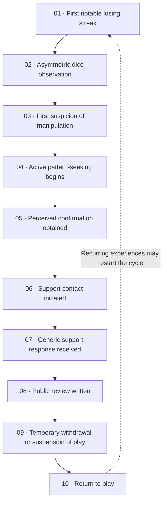

# Figures and Research Visuals

This index documents the figures and visual models supported by the two research manuscripts. It provides source-grounded specifications for possible visualisations. No chart image files, raw datasets, or underlying calculation sheets are included in this repository.

The figures distinguish between findings reported in the manuscripts, interpretive models developed through qualitative analysis, and cross-study comparisons. Where the manuscripts report different values or conceptual mappings, these differences are preserved rather than reconciled.

## Figure 1 — Persian-language fairness-related complaint rate: shared endpoints

**Recommended form:** two-point comparison, endpoint slope marker, or minimal line segment.

| Year | Rate | Source |
|---|---:|---|
| 2022 | 3% | Both manuscripts |
| 2026 | 18% | Both manuscripts |

**Caption:** Both manuscripts report an increase from 3% in 2022 to 18% in 2026 in the proportion of one-star reviews containing fairness-related complaints in the Persian-language corpus. Intermediate annual values differ between the manuscripts and are therefore not represented as a single reconciled series.

**Important interpretation:** This is a rate reported within the sampled review corpus. It is not a measure of the proportion of all players who distrust the game, nor does it establish that the game system technically manipulated outcomes.

The full source-specific series are:

**Longitudinal manuscript — Table 1**

| Year | Rate |
|---|---:|
| 2022 | 3% |
| 2023 | 8% |
| 2024 | 10% |
| 2025 | 17% |
| 2026 | 18% |

**Cross-cultural manuscript — Table F1**

| Year | Rate |
|---|---:|
| 2022 | 3% |
| 2023 | 5% |
| 2024 | 8% |
| 2025 | 12% |
| 2026 | 18% |

These are source-specific values. The discrepancy in intermediate years remains unresolved in the available materials.

## Figure 2 — Seven operational themes

**Recommended form:** theme taxonomy or hierarchical diagram.

The seven operational themes were identified through the qualitative analysis of player discourse. Both manuscripts use the same seven theme labels.

**Source:** Both preprints.

The taxonomy represents recurring forms of player belief and complaint. It does not establish that the alleged system behaviours occurred.

No frequencies or relative importance are implied by the diagram.

## Figure 3 — Source-specific meta-theme mappings

The two manuscripts organise the seven operational themes into three higher-order meta-themes. Two mappings are consistent across both manuscripts; the Perceived Agency mapping differs.

### 3A. Longitudinal manuscript

**Source:** Longitudinal manuscript, Section 5.3.

The manuscript assigns identical theme membership to Perceived Agency and Statistical Misinterpretation. This is reproduced as published and flagged for author clarification rather than silently corrected.

### 3B. Cross-cultural manuscript

**Source:** Cross-cultural manuscript, Section 5.3.

The cross-cultural manuscript assigns T04 to Perceived Agency Erosion and does not include T06 in that meta-theme. Its mapping is preserved independently of the longitudinal manuscript.

## Figure 4 — Corpus overview

**Recommended form:** two-branch corpus diagram or structured comparison table.

The manuscripts describe related but distinct sampling and analysis procedures. The following table keeps the corpus sizes and detailed samples separate.

| Dataset | Reported size | Role and sampling context |
|---|---:|---|
| Persian-language review corpus | 52,000+ reviews | Primary longitudinal corpus; October sampling window across 2022–2026 |
| Longitudinal detailed sample | ≈500 review and support items | Purposive qualitative coding across five annual cohorts |
| Cross-cultural Persian-language detailed sample | ≈500 reviews | Purposive qualitative coding across five annual cohorts |
| Supplementary Persian-language support corpus | Not quantified in the manuscript | Anonymised support interactions used as supplementary qualitative material |
| Anglophone source corpus | 4,116 reviews | One-star and two-star reviews from an Australian app-store market listing, January 2022–October 2026 |
| Anglophone detailed sample | 750 reviews | Stratified random sample; 150 reviews per year, using random seed 42 |

**Important distinctions:**

- The longitudinal manuscript describes a review corpus collected across multiple mobile app marketplaces and a detailed sample of approximately 500 review and support data items.
- The cross-cultural manuscript identifies Myket and Cafe Bazaar as the Persian-language review sources and reports approximately 500 reviews selected for detailed coding.
- The cross-cultural manuscript also uses a supplementary anonymised support-interaction corpus. Its size is not specified.
- The anglophone source corpus contains 4,116 one-star and two-star reviews. The 750-review analytical sample is stratified by year, with 150 reviews per year.
- The anglophone 2026 cohort covers reviews posted through 6 October 2026.

The two Persian-language detailed samples should not be assumed to contain identical records or to be interchangeable.

## Figure 5 — Player Journey of Distrust

The two manuscripts present related ten-stage interpretive models. Their labels and descriptions differ in several places. They should be visualised separately.

### 5A. Longitudinal manuscript

**Recommended form:** ten-stage sequential journey diagram.

**Source:** Longitudinal manuscript, Section 5.4.

Stages 03, 05, 07, and 09 are identified as particularly important transition points in the manuscript.

The model is interpretive, not deterministic. It represents recurring patterns identified in the dataset rather than a universal sequence followed by every player.

### 5B. Cross-cultural manuscript

**Recommended form:** ten-stage cyclical journey diagram.

**Source:** Cross-cultural manuscript, Section 5.4.

Stages 03, 05, 07, and 09 are identified as potentially influential intervention points.

The manuscript explicitly describes the model as cyclical rather than strictly linear. Players may temporarily withdraw and subsequently return to play while retaining earlier concerns.

**Important distinction:** The two models should not be merged into a single definitive journey. In particular:

- Stage 02 is labelled "Asymmetric outcome observation" in the longitudinal manuscript and "Asymmetric dice observation" in the cross-cultural manuscript.
- Stage 07 is "Perceived support dismissal" in the longitudinal manuscript and "Generic support response received" in the cross-cultural manuscript.
- Stage 08 is "Public complaint or warning" in the longitudinal manuscript and "Public review written" in the cross-cultural manuscript.
- Stage 09 is "Temporary disengagement" in the longitudinal manuscript and "Temporary withdrawal or suspension of play" in the cross-cultural manuscript.
- The cross-cultural manuscript explicitly describes the model as cyclical.

## Figure 6 — Cross-cultural comparison

**Recommended form:** qualitative comparison matrix.

| Dimension | Persian-language corpus | Anglophone corpus |
|---|---|---|
| Dice manipulation | Dominant theme throughout the study period | Approximately 51% of the 750-review sample |
| Fairness complaint trajectory | Increasing prominence across the five-year period | Comparatively stable prevalence in the sampled reviews |
| Bot-opponent suspicion | Present relatively early and increasingly prominent | Low initial prevalence, increasing over time |
| Statistical framing | Increasing sophistication in the use of observations and probability-related claims | Frequent use of numerical and probability-related reasoning |
| Complaint framing | References to fate, destiny, honour, and injustice | More frequent references to fraud, consumer rights, and commercial legitimacy |
| Support dismissal | Evident in supplementary support interactions | Reflected in public review-response patterns |
| Developer-response visibility | Primarily private support channels | Public review-response infrastructure |

**Source:** Cross-cultural manuscript, Section 5.6 and Table 5.

**Interpretive caution:** This is a qualitative comparison, not a direct comparison of equivalent population-level measures. The Persian-language and anglophone corpora use different sampling frames, time windows, and denominators.

The Persian-language analysis uses a purposive October sampling window. The anglophone analysis uses a stratified sample drawn across available months. Their numerical percentages should not be plotted as directly comparable values.

## Figure 7 — Anglophone theme frequencies

**Recommended form:** horizontal bar chart for overall frequencies, with a separate year-level display for themes with reported annual percentages.

The cross-cultural manuscript reports the following AI-assisted theme frequencies for the anglophone sample (n = 750):

| Theme | Overall frequency |
|---|---:|
| T01 · Dice Manipulation | ≈51% |
| T02 · Pay-to-Win Mechanics | ≈18% |
| T03 · Bot Opponents | ≈9% |
| T04 · Connectivity Sabotage | ≈1% |
| T05 · Predetermined Outcomes | ≈5% |
| T06 · Statistical Anomaly Reporting | ≈13% |
| T07 · Support Dismissal | <1% |

Year-level percentages reported in Table 3:

| Theme | 2022 | 2023 | 2024 | 2025 | 2026 |
|---|---:|---:|---:|---:|---:|
| T01 · Dice Manipulation | 55% | 53% | 52% | 50% | 45% |
| T02 · Pay-to-Win Mechanics | 23% | 17% | 11% | 19% | 19% |
| T03 · Bot Opponents | 3% | 8% | 11% | 11% | 11% |
| T06 · Statistical Anomaly Reporting | 13% | 11% | 17% | 11% | 11% |

The source table does not report year-level percentages for T04, T05, or T07. Dashes in the manuscript indicate that no year-level percentage is reported; they must not be interpreted as zero.

**Methodological caution:** These are AI-assisted preliminary classification frequencies, reviewed and interpreted qualitatively. They are indicative rather than definitive human-coded prevalence estimates.

## Figure 8 — Developer-response patterns

**Recommended form:** categorical bar chart or proportional stacked bar.

The cross-cultural manuscript reports the following response categories in the anglophone sample:

| Response pattern | Approximate prevalence |
|---|---:|
| Generic empathy and fairness assurance | 26% |
| Explicit RNG explanation and fairness claim | 10% |
| Redirection to external support channels | 9% |
| Hybrid combinations of the above patterns | 24% |
| Personalised or substantially customised responses | 31% |

The manuscript reports an approximately 99% developer reply rate across the 750-review sample.

The four template categories together account for approximately 69% of responses. Personalised or substantially customised responses account for approximately 31%.

**Caption:** Developer-response patterns identified in the anglophone review sample (n = 750). Percentages are approximate and reflect the categories reported in the cross-cultural manuscript.

These values describe the sampled review-response corpus only. They should not be generalised to all developer communications or mobile gaming platforms.

## Figure production rules

- Identify the source manuscript for every statistic, model, or taxonomy.
- Include the denominator and sampling context wherever a percentage is displayed.
- Preserve the different annual Persian-language complaint rates reported by the two manuscripts.
- Do not combine the two Player Journey models into one model.
- Preserve the source-specific meta-theme mappings.
- Distinguish empirical findings, qualitative interpretations, and design implications.
- Do not infer causality from observational review or support-interaction data.
- Do not present player allegations as verified system behaviour.
- Do not interpret AI-assisted preliminary classifications as definitive human-coded results.
- Do not plot Persian-language and anglophone percentages as directly comparable measures.
- Do not interpret missing year-level percentages as zero.
- Do not include raw or searchable user quotations.
- Do not include client or game names, logos, app-store links, screenshots, or identifying metadata.
- Do not include private support transcripts, user identifiers, or raw datasets.
